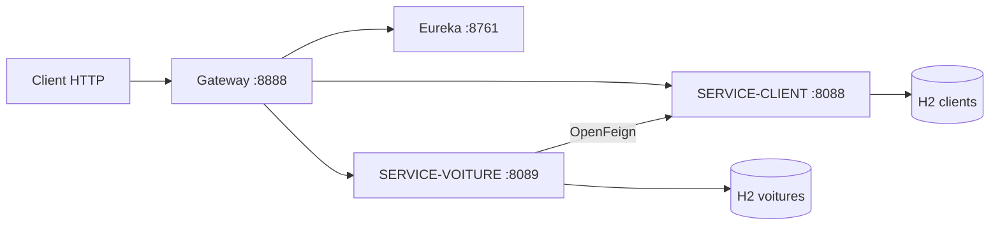

# TP19 — Orchestration de microservices avec Spring Cloud

Implémentation du [TP 19 du cours Architecture Microservices](https://mliaedu.toubkalit.com/student/courses/7/labs/235) : Eureka, Gateway, deux services Spring Boot, H2 et un appel OpenFeign.



## Prérequis

- JDK 17 ou plus et Maven 3.9+
- Ports libres : 8761, 8088, 8089 et 8888
- Aucune installation de base de données : chaque service utilise sa propre base H2 en mémoire

Le projet est un reactor Maven à quatre modules. Il utilise Spring Boot 3.5.15 et le BOM Spring Cloud 2025.0.3. La classe `Voiture` conserve uniquement `clientId` en base ; sa propriété `client` est enrichie à la lecture via OpenFeign. Aucun lien JPA ne traverse les bases des deux services.

## Compiler et tester

À la racine du projet :

```powershell
mvn -B -ntp clean verify
```

Pour vérifier les quatre applications ensemble après `mvn package`, exécuter :

```powershell
./scripts/smoke-test.ps1
```

Le script démarre les services, vérifie Eureka, les routes Gateway statiques et dynamiques, l'appel Feign et les opérations `POST`, `PUT`, `DELETE` sur les voitures. Il arrête uniquement les processus qu'il a lancés et conserve leurs journaux sous `target/smoke-test/`.

## Démarrer

Ouvrir quatre terminaux et lancer les commandes dans cet ordre, depuis la racine du projet :

```powershell
java -jar eureka-server/target/eureka-server-1.0-SNAPSHOT.jar
java -jar service-client/target/service-client-1.0-SNAPSHOT.jar
java -jar service-voiture/target/service-voiture-1.0-SNAPSHOT.jar
java -jar api-gateway/target/api-gateway-1.0-SNAPSHOT.jar
```

Attendre que chaque application soit démarrée avant de lancer la suivante. La console Eureka se trouve à <http://localhost:8761/> et doit afficher `SERVICE-CLIENT`, `SERVICE-VOITURE` et `GATEWAY`.

## Vérifier les routes

| URL | Rôle |
| --- | --- |
| <http://localhost:8088/clients> | Clients directement |
| <http://localhost:8088/client/1> | Un client directement |
| <http://localhost:8089/voitures> | Voitures avec clients obtenus par Feign |
| <http://localhost:8089/voitures/1> | Une voiture enrichie |
| <http://localhost:8089/voitures/client/1> | Voitures d'un client |
| <http://localhost:8888/clients> | Route Gateway vers `SERVICE-CLIENT` |
| <http://localhost:8888/client/1> | Route Gateway vers un client |
| <http://localhost:8888/voitures> | Route Gateway vers `SERVICE-VOITURE` |
| <http://localhost:8888/SERVICE-CLIENT/clients> | Route par nom de service |
| <http://localhost:8888/SERVICE-VOITURE/voitures> | Route par nom de service |

Exemples PowerShell :

```powershell
Invoke-RestMethod http://localhost:8888/clients
Invoke-RestMethod http://localhost:8888/voitures/1
Invoke-RestMethod http://localhost:8888/SERVICE-VOITURE/voitures
```

Les données initiales sont trois clients (Rabab, Amal et Samir) et trois voitures (Toyota, Renault et Peugeot). Les services exposent aussi `POST`, `PUT` et `DELETE` sur `/clients` ou `/voitures` selon le contrôleur.

## Variante Gateway statique

La Gateway utilise Eureka et `lb://` par défaut. Pour tester l'étape de routage vers des adresses fixes, lancer uniquement la Gateway avec le profil `static` :

```powershell
java -jar api-gateway/target/api-gateway-1.0-SNAPSHOT.jar --spring.profiles.active=static
```

Dans ce profil, `/clients`, `/client/{id}` et `/voitures` sont dirigés vers `localhost:8088` et `localhost:8089`. Eureka n'est pas nécessaire pour la Gateway statique, mais le service Voiture en a toujours besoin pour son appel Feign au service Client.

## Notes de mise en œuvre

- Le TP mélange une configuration Gateway MVC et une classe `RouteLocator` WebFlux. Cette version emploie Gateway WebFlux de façon cohérente.
- Le TP associe `@ManyToOne` à un objet `Client` non persistant dans le service Voiture. Cette version emploie `@Transient` pour l'objet distant et persiste `clientId`.
- L'endpoint client `/clients/{id}` est fourni en plus de `/client/{id}` afin que l'interface Feign puisse l'appeler sans décalage de chemin.

## Résultat vérifié

Le 10 novembre 2026, `mvn -B -ntp package` a réussi. Les deux tests d'intégration JUnit ont réussi. Le script `smoke-test.ps1` a confirmé les trois clients, les trois voitures, leur association via OpenFeign, les routes Gateway avec Eureka et le profil statique, puis la création, la modification et la suppression d'une voiture via la Gateway.
